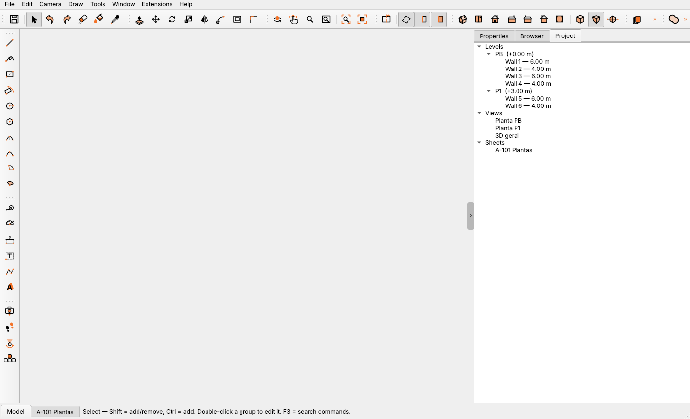
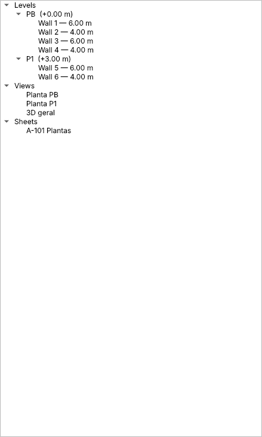
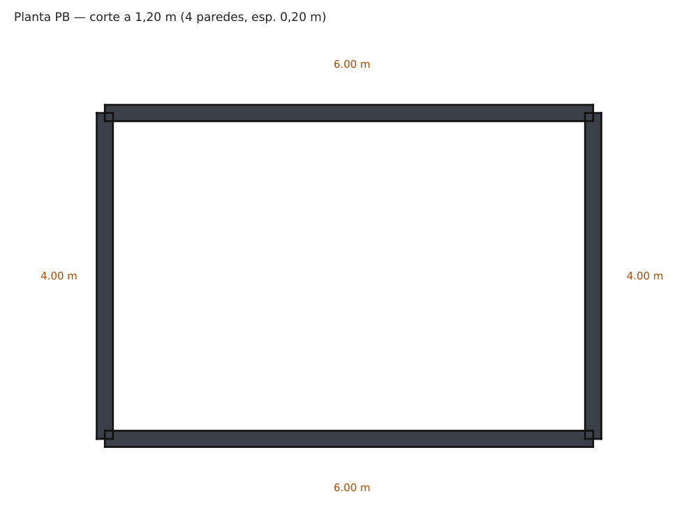
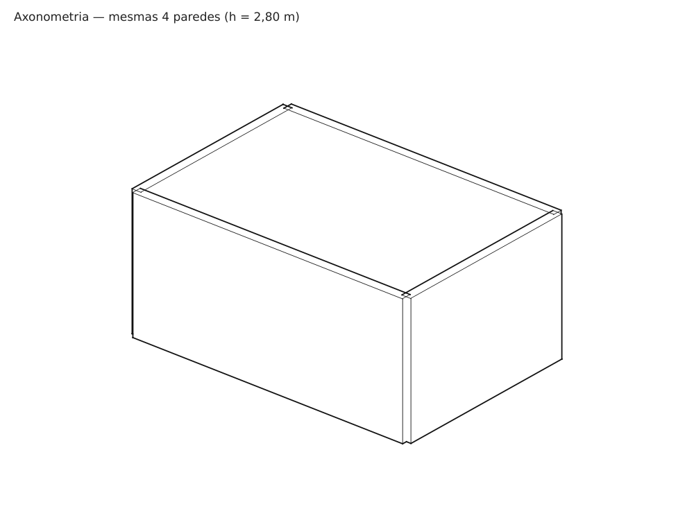
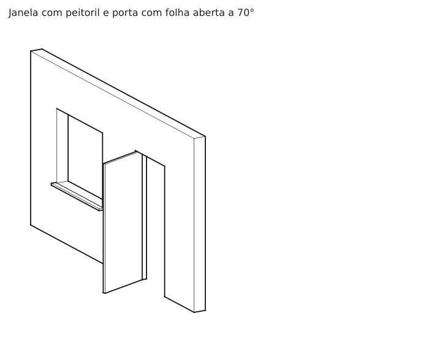
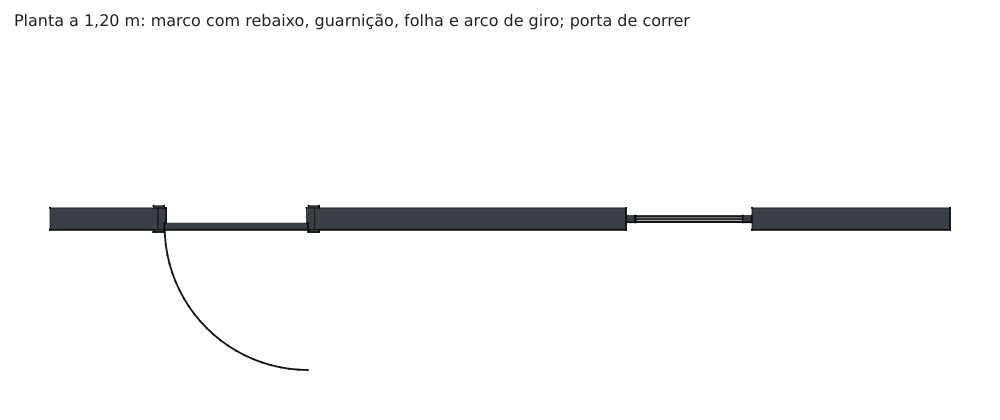
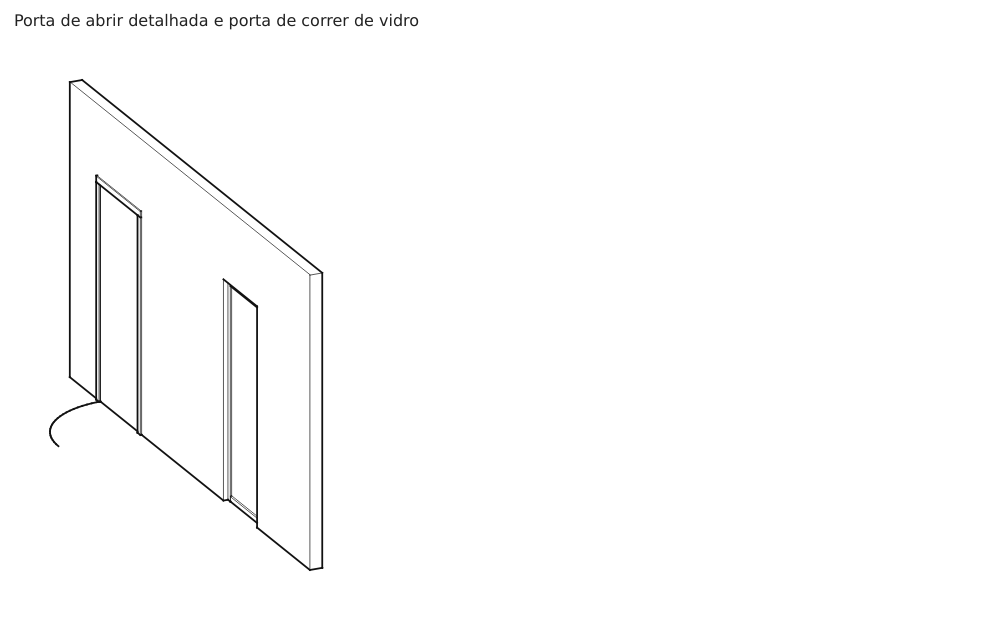
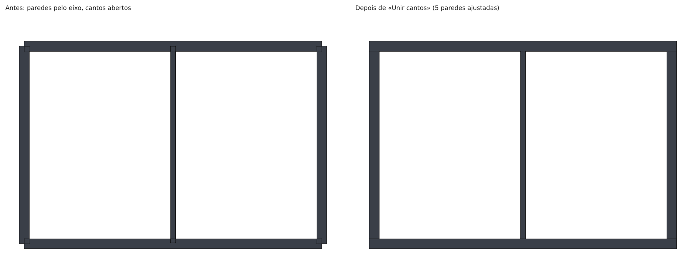
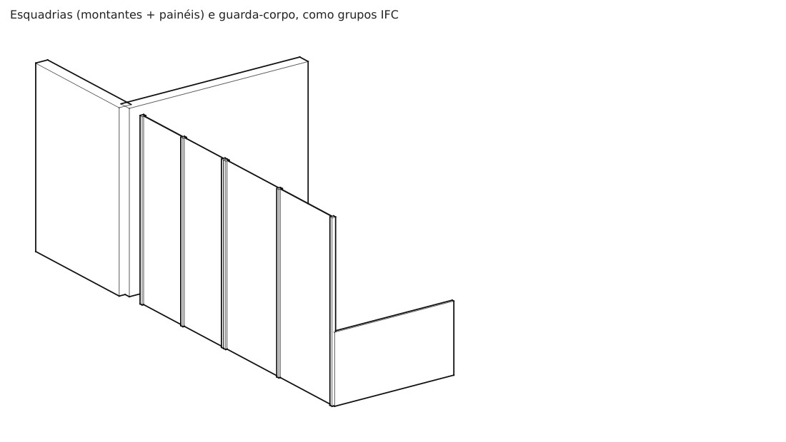

# Spike de viabilidade — BIM leve (Conceito) só com extensões

Data: 2026-10-16 · branch `spike/viabilidade-bim` · escopo tocado: `plugins/`,
`tests/` e `docs/` (nada em `core/`, `tools/` ou `views/`).

**Objetivo.** Saber se dá para construir, só com extensões, um BIM leve para a
fase de Conceito (planta + 3D): navegador de projeto, pavimentos, vistas,
desenho 2D paramétrico (parede, vão, zona de piso, ambientes), cenários e
pranchas.

**Veredito curto.** A espinha dorsal já existe e funciona: dados do projeto e
por objeto são salvos no `.igz`, comandos próprios dão um passo de desfazer,
vistas/cortes/pranchas são dados públicos que persistem, e uma ferramenta de
desenho com clique, inferência e valor digitado é escrevível. **Dá para
começar sem tocar no núcleo**, com três ressalvas que viram trabalho no
núcleo assim que o produto passar de protótipo: (1) ferramenta de desenho
persistente e exportação de prancha só existem por caminhos não documentados
(`FRAGILE`); (2) nada que a extensão desenha em 2D vai para a prancha — só a
geometria do modelo vai; (3) o núcleo não avisa a extensão quando um objeto
dela é movido. A lista completa está na seção 3.

> Os exemplos citados ("Levels" e "Windowizer") **não estão em `plugins/`**:
> estão em `examples/extensions/niveles.py` e
> `examples/extensions/windowizer.py` (instalados pelo gerenciador de
> extensões; `docs/plugins.md:302-317`). `plugins/` traz só os plugins que
> acompanham o aplicativo (`model_info`, `python_console`, `solid_inspector`,
> `ai_assistant`, `ai_bridge`, `render_blender`).

---

## 1. As seis perguntas

| # | Pergunta | Resposta | Em uma frase |
|---|----------|----------|--------------|
| 1 | Painel lateral com árvore (pavimentos, plantas, cortes, 3D, cenários) | **SIM** (provado na janela real) | `add_panel` aceita qualquer `QWidget`; a árvore é da extensão, não do Navegador nativo. O protótipo agora tem a aba «Project» (imagem na seção 2). |
| 2 | Guardar dados do projeto inteiro no arquivo salvo (não só em grupos) | **SIM** | `scene.plugin_data[chave]` (projeto) e `group.ext[chave]` (objeto) vão no `.igz`. |
| 3 | Criar vistas e cenas por código, com plano de corte | **SIM** (com ressalvas) | `SavedView` e `SectionPlane` são públicos e persistem; criar não é desfazível pelo núcleo e a vista não tem `uid`/metadados. |
| 4 | Ferramentas de desenho 2D (parede por linha com espessura, vão), com inferências e entrada numérica | **PARCIAL** | Clique, inferência, ímã de eixo e VCB funcionam (provado com a parede). Faltam: ferramenta persistente documentada, aresta com espessura, achar a parede sob o cursor. |
| 5 | Regenerar a geometria 3D a partir de parâmetros guardados, num passo de desfazer | **SIM** | Padrão do Windowizer, provado em `plugins/bim_proto.py`; o núcleo não avisa quando o objeto é movido. |
| 6 | Acrescentar prancha ou modelo de página ao compositor e exportar PDF ou SVG | **PARCIAL** | Prancha: sim (dados públicos). Modelo: só por arquivo JSON. PDF: só por caminho privado. SVG: não existe. |

As evidências executáveis estão em `tests/test_bim_proto.py` (71 testes) e
`tests/test_spike_viabilidade.py` (7 testes); cada afirmação abaixo diz qual
teste a sustenta, quando há.

### Convenção de "público"

* **Contrato** — descrito em `docs/plugins.md` ou `views/extension_api.py`.
* **Público não documentado** — nome sem `_`, usado por um exemplo do
  repositório, mas fora do contrato. No código do protótipo leva `FRAGILE`.
* **Interno** — nome com `_`. Só aparece nos testes, sempre com `FRAGILE`.

A API de extensões é declarada instável (`docs/plugins.md:3-4`;
`API_VERSION = 2`, `views/extension_api.py:45`) e os *workspaces* são
"provisórios" (`docs/plugins.md:266-269`). Tudo abaixo vale para a versão deste
repositório.

---

### P1 — Painel lateral com árvore: **SIM**

**Evidência.**
* `ExtensionApp.add_panel(title, widget, ...)` põe qualquer widget como aba da
  bandeja lateral, com nome de objeto estável (o layout lembra a posição), item
  em *Janela ▸ Painéis* e opção `start_hidden`
  (`views/extension_api.py:113-173`; `views/main_window.py:2612-2652`).
  Nada limita o widget: um `QTreeWidget` serve. O "Levels"/Niveles faz isso
  com lista e diálogo (`examples/extensions/niveles.py:288`); o Solid
  Inspector e o Render com Blender são painéis maiores
  (`docs/plugins.md:319-340`).
* Atualização: `app.on_document_changed(fn)` dispara em edição, desfazer,
  Novo e Abrir (`views/extension_api.py:107-110`).
* Dados para alimentar a árvore: `scene.groups`, `scene.saved_views`,
  `scene.section_planes`, `scene.compositions`, `scene.layers` — todos campos
  públicos de `Scene` (`core/scene.py:75-78,136`).

**O que falta / cuidado.**
* Não há como acrescentar nós ao Navegador nativo. `add_outliner_kind` só
  rotula, por linha, *grupos que são da extensão* (tipo + propriedades no
  tooltip; `views/extension_api.py:227-241`). Pavimentos/vistas viriam numa
  árvore própria, ao lado do Navegador — duas árvores na tela.
* Duplo clique numa vista da árvore deve "aplicar a vista". O núcleo faz isso
  em `views/tray.py:3848-3883`: `SavedView.apply(scene, viewport.camera)` e
  depois passos que são privados do painel (`_sync_style_menu`,
  `tray.layers.refresh()`, comparação de `shown_state` para decidir se há
  `scene.version += 1`). A extensão só consegue reproduzir `apply` +
  `notify_scene_changed`; menu de estilo e aba Camadas podem ficar
  dessincronizados. **Não verificado (exige GUI).**

---

### P2 — Dados do projeto inteiro no arquivo salvo: **SIM**

**Evidência.**
* Projeto: `scene.plugin_data` — um valor JSON por extensão, "salvo no .igz,
  zerado por Novo/Abrir, cada alteração é um passo de desfazer"
  (`core/scene.py:115-119`; `core/history.py:106-136`
  `SetPluginDataCommand`; `views/extension_api.py:79-97`
  `document_data`/`set_document_data`). Gravação em `formats/igz.py:571-583`,
  leitura em `formats/igz.py:1146-1147`.
* Objeto: `group.ext[chave]`, "mantido nas cópias, salvo no .igz"
  (`core/group.py:64-69`; gravação `formats/igz.py:503-506`, leitura
  `formats/igz.py:1086-1087`; grupos filhos incluídos, `igz.py:522`).
* Provado: `test_the_parameters_survive_save_and_reopen`
  (`tests/test_bim_proto.py`) salva com `igz.save_scene`, reabre com
  `igz.load_into` e confere `plugin_data` (níveis) e `ext` (paredes) iguais.
  O protótipo usa exatamente essa divisão: níveis em `plugin_data`, parâmetros
  de cada parede em `group.ext`.

**O que falta / cuidado.**
* Não há campo de extensão em `SavedView`, `Composicion`, `SectionPlane`,
  `Layer` nem em face solta (`face.attrs["ifc"]` é do núcleo, `core/bim.py:13-15`).
  Metadados de vista/prancha precisam ir em `plugin_data`, ligados **pelo
  nome** (ver P3).
* Valores não JSON: em `plugin_data` a chave inteira é descartada em silêncio
  no salvar (`igz.py:577-583`); em `group.ext` vira texto (`default=str`,
  `igz.py:506`). Ambos sem aviso — o dado "some" ou "muda de tipo" sem erro.
* Sem versão de esquema nem migração: a extensão precisa carregar
  `"version"` no próprio registro.
* Duas fontes de verdade (níveis em `plugin_data`, paredes em `ext`) exigem
  que a extensão trate referências soltas (`level` apagado) — o protótipo
  recusa a atualização (`level_z` levanta `BimProtoError`).

---

### P3 — Vistas e cenas por código, com plano de corte: **SIM (com ressalvas)**

**Evidência.**
* `SavedView(name, target, distance, yaw, pitch, perspective, ..., section=)`
  é uma classe de dados pública; `capture`, `recapture`, `apply`, `to_dict`
  (`core/saved_views.py:18-208`). Uma planta é `pitch≈89°`, `perspective=False`.
* `SectionPlane(point, normal, name, symbol)` é público
  (`core/section.py:80-117`); `PlaceSectionPlaneCommand` e
  `SetActiveSectionCommand` são comandos desfazíveis
  (`core/history.py:1387-1409,1451-1469`). Uma vista guarda qual plano está
  ativo (`SavedView.section["active"]` = `uid` do plano,
  `saved_views.py:42-50`).
* Provado (`tests/test_spike_viabilidade.py`): um corte horizontal a 1,20 m
  (`normal=+Z`), uma vista "Planta PB" apontando para ele, uma prancha com um
  quadro `view_key="scene:Planta PB"` e dados de extensão sobrevivem a salvar
  e reabrir; `SavedView.apply` devolve câmera e corte; e
  `core.hlr.hlr_drawing` (NumPy, sem GL) devolve **2 anéis de poché** para 2
  paredes cortadas — ou seja, a "planta" de um pavimento é o corte horizontal
  do 3D, sem desenho 2D separado.
* `scene.saved_views`, `scene.section_planes` e `scene.compositions` são
  gravados no `.igz` (`formats/igz.py:539-544`, leitura `1029-1038`).

**O que falta / cuidado.**
* **Criar cena não é desfazível no núcleo**: o painel faz
  `scene.saved_views.append(...)` direto (`views/tray.py:3893-3903`). A
  extensão precisa embrulhar em um `Command` próprio (mesmo padrão do
  protótipo) para ser desfazível.
* **`SavedView` não tem `uid` nem campo livre** (`saved_views.py:21-26`); a
  identidade é o nome. Renomear no Navegador atualiza os quadros de prancha
  (`core/outliner.py:165` `rename_scene`) mas não a tabela da extensão em
  `plugin_data` → vínculo "vista ↔ pavimento" quebra em silêncio se não for
  reconciliado por nome ou por posição.
* "Um corte ativo por contexto" (`saved_views.py:42`): uma planta por
  pavimento exige um `SectionPlane` por pavimento e uma cena por pavimento.
  Esconder o que não é do pavimento é por camada (`hidden_layers`, por nome) ou
  `hidden_objects` (uids de grupo) — ambos públicos.
* O painel de Cenas do núcleo pode não enxergar cenas criadas por código até
  um refresh. **Não verificado (exige GUI).**

---

### P4 — Ferramentas de desenho 2D com inferências e entrada numérica: **PARCIAL**

**Evidência — o que funciona.**
* Uma `Tool` (`tools/base.py:525`) recebe `on_click(ctx)` / `on_hover(ctx)`
  com `ctx.world` **já encaixado** pelo motor de snap e `ctx.snap`
  (`SnapResult`, `core/snap.py:82`); desenha o elástico por
  `rubber_band_lines()` (`base.py:680`); recebe o comprimento digitado em
  `on_value(viewport, value)` com `vcb_label` (`base.py:561,638`; o
  viewport entrega `float` ou tupla `(dx, dy, dz)`, `views/viewport.py:13504`).
* O ímã de eixo (X/Y/Z a 3°) é o mixin público `AxisMagnet`
  (`tools/base.py:38-98`), usado pelas ferramentas de arco e herdado por
  `WallTool`.
* Inferências extras: `app.add_snap_provider` (`extension_api.py:269-272`;
  nunca sobrepõe ponto nomeado — `docs/plugins.md:198-203`), `app.add_overlay`
  para guias (`:255-260`) e `app.add_pickable` para itens próprios selecionáveis
  (`:274-291`).
* Provado com a parede por dois pontos (`plugins/bim_proto.py` `WallTool`):
  clique-clique cria a parede; clique + comprimento digitado segue a direção do
  elástico; Esc descarta; comprimento zero não cria nada
  (`tests/test_bim_proto.py`, seção "the tool").

**O que falta.**
1. **Ferramenta persistente não tem API.** Uma `Tool` achada pelo carregador
   vira entrada de menu de um disparo: só `on_activate` roda e a ferramenta
   ativa não muda (`docs/plugins.md:45-47`; `views/main_window.py:2658-2668`;
   teste `test_a_plugin_tool_found_by_the_loader_is_one_shot`). Para ficar
   ativa, a extensão chama `viewport.set_active_tool(tool)` (`viewport.py:11608`)
   — público, mas **fora do contrato** (único precedente:
   `plugins/render_blender.py:1015`). Por isso `WallTool` exige `app` no
   construtor: assim o carregador a ignora (`core/extensions.py:174-186`,
   documentado) e a extensão a monta no `setup`. Sem ícone de barra de
   ferramentas, sem atalho persistente, sem entrada de ferramenta no F3.
2. **Não existe "linha com espessura".** `Edge` não tem largura. "Parede por
   linha com espessura" vira prisma 3D (o protótipo) e a espessura aparece na
   planta pelo corte. Desenho 2D puro (linha grossa, arco de porta) só existe
   como `add_overlay` — que **é do viewport e não vai para a prancha** (P6).
3. **Vão numa parede** exige saber qual parede está sob o cursor. `ToolContext`
   não traz a entidade tocada. Em planta o problema é 2D (ponto sobre
   segmento dos registros `a→b` guardados), então é resolúvel pela extensão;
   e o núcleo aceita faces com furos (`Face.hole_loops`, usado pelo
   Windowizer), então a parede com vão se regenera de parâmetros. **Não foi
   prototipado** — só a parede foi.
4. Entrada numérica: um campo só (`vcb_label`); espessura/altura/nível ficam
   em atributos da ferramenta, ligáveis a um painel (não construído).

---

### P5 — Regenerar o 3D a partir de parâmetros, num único passo de desfazer: **SIM**

**Evidência.**
* `Command` é público (`core/history.py:94-103`). O Windowizer mostra o padrão:
  um comando que fotografa lista de grupos, malhas, `ext`, etiquetas e
  matrizes, executa a mutação e restaura tudo ao desfazer
  (`examples/extensions/windowizer.py:1203-1254`; reconstrução de uma janela
  a partir de `group.ext` em `:1178-1190`).
* **Por que o comando precisa ser próprio:** `History.execute` só reverte a
  malha ativa (`scene.mesh`) quando algo falha (`core/history.py:174-205`);
  grupos, `ext` e `plugin_data` ficam como estavam no meio da falha. `BimProtoCommand` repete o padrão e
  se desfaz sozinho em caso de erro.
* Provado em `tests/test_bim_proto.py`:
  * `update_3d` de duas paredes = **1 passo** (`len(undo_stack)+1`); um
    `undo()` devolve a geometria das duas; `redo()` refaz;
  * `edit_walls(vp, paredes, height=..., thickness=...)` muda parâmetros **e**
    regenera em 1 passo; `undo()` devolve parâmetros e geometria juntos;
  * registro inválido em qualquer parede reverte o lote inteiro e não deixa
    passo na pilha;
  * depois de salvar e reabrir, "Atualizar 3D" reproduz a geometria idêntica.

**O que falta / cuidado (achados do protótipo).**
* **O núcleo não avisa a extensão de transformações.** Girar uma parede (comando
  do núcleo) muda os vértices e deixa `group.ext["bim_proto"]` desatualizado;
  "Atualizar 3D" então a devolve para onde o registro manda
  (`test_rotating_a_wall_leaves_its_parameters_stale_until_update_3d`). O
  caminho sem mexer no núcleo é o do Windowizer: contêiner + partes com
  matriz (`xform`/"pose"), em que mover é só trocar a matriz e a extensão a
  lê de volta (`windowizer.py:942-952`). O protótipo usa grupo clássico por
  simplicidade; um produto deveria adotar o contêiner com pose.
* **Editar `ext` "no lugar", fora de um comando, não é desfazível** (a edição
  entra no estado "antes" do passo seguinte). Toda edição de parâmetro deve
  passar por um comando — por isso `edit_walls`.
* `regenerate_wall` **troca o objeto `group.mesh`** em vez de editar a malha no
  lugar (marcado `FRAGILE` no código). Comandos do núcleo guardam o grupo,
  não a malha, e o desfazer em ordem inversa restaura a malha antiga; mas
  nenhum contrato diz que a identidade da malha é estável, e cache de
  desenho por malha não foi observado (**exige GUI**).
* `History.max_steps = 200` (`core/history.py:163`): cada passo guarda referências às
  malhas antigas; um "Atualizar 3D" em projeto grande custa memória por passo.

---

### P6 — Prancha ou modelo de página no compositor; exportar PDF ou SVG: **PARCIAL**

**Evidência.**
* **Prancha: SIM, por dados públicos.** `Composicion` e `MarcoVista` são
  `dataclass` sem Qt (`core/composition.py:193,1322`); `AddSheetCommand`
  e `PlaceViewCommand` (`core/history.py:1542-1572`) as colocam em
  `scene.compositions` desfazendo; vão para o `.igz`
  (`igz.py:542-544,1033-1038`). Um quadro aponta uma cena por
  `view_key="scene:<nome>"` e uma escala `scale_n` (`composition.py:196-206`).
  Provado em `test_views_cut_planes_and_sheets_made_by_code_survive_a_reopen`.
* **Modelo de página: PARCIAL.** Modelos são arquivos
  `*.json` (`Composicion.to_dict()`) numa pasta `plantillas` em
  `AppDataLocation` (`views/composer.py:8793-8850`). Uma extensão pode gravar
  esse JSON e `ComposerWindow.new_sheet_from_template` o usa — mas o caminho
  da pasta vem de um método da janela do compositor, não de API de extensão.
  Não exercitado.
* **PDF: só por caminho privado.** O PDF é um método da janela do compositor:
  `export_pdf` / `export_all_pdf` (`views/composer.py:12650,12666`), alcançada
  por `MainWindow._ensure_composer()` (`views/main_window.py:4765`,
  **privado → `FRAGILE`**). Provado que funciona offscreen para uma prancha
  **sem quadros de vista** (`test_a_sheet_made_by_code_exports_to_pdf_through_the_composer`;
  o mesmo truque que `tests/test_outliner.py:1511-1520` usa: "no GL renders").
* **SVG: não existe.** Nenhuma ocorrência de SVG em `views/composer.py`.
  O que existe de vetorial é DXF por vista (`composer.py:6911`) e o passe
  `core.hlr` (`hlr_drawing`, headless, comprovado em P3). Uma extensão
  poderia escrever o próprio SVG de planta a partir de `hlr_drawing`, mas não
  herda pesos de linha, textos, carimbo nem escala da prancha.

**O que falta.**
* Nada que a extensão desenhe em 2D chega à prancha: o quadro de vista
  renderiza o **modelo** (`render_frame`, `composer.py:12405`; estilo
  `"vectorial"` usa o HLR, os outros usam GL). Hachura de ambiente, arco de
  porta, rótulo de área, cota própria precisam ser **geometria real** do
  modelo (poluindo o 3D, numa camada à parte) ou de um gancho que não existe.
* Tipos de item novos na prancha: não há (`Composicion.all_items`,
  `composition.py:1378-1389`, é uma lista fixa), nem campos `{campo}` novos
  (`field_values`, `composition.py:1540-1573`).
* Quadros com render GL (sombreado) não foram exercitados aqui. **Exige GUI/GL.**

---

## 2. O protótipo (Parte 2)

`plugins/bim_proto.py` (menu *Extensões ▸ BIM proto*):

| Peça | Como |
|------|------|
| Ferramenta | `WallTool` (`AxisMagnet` + `Tool`): 2 cliques, ou clique + comprimento digitado. Espessura/altura/nível são atributos da ferramenta. |
| Parâmetros da parede | `group.ext["bim_proto"] = {kind, a, b, thickness, height, level, base_offset}` — por objeto, no `.igz`. |
| Níveis | `scene.plugin_data["bim_proto"]["levels"] = [{id, name, z}]` — do projeto, no `.igz`. Sempre existe `PB`. |
| Geometria | derivada: prisma fechado (6 faces, normais para fora), `z = z(nível) + base_offset`. Volume = comprimento × espessura × altura (teste). Etiqueta `IfcWall` via `core.bim.tag_group`. |
| Vãos | `wall_gaps(registros)` acha as lacunas de porta; `merge_gap_walls` as funde numa parede contínua com `openings` (porta = entalhe, janela = furo). Sem fundir, a verga é `create_walls(..., base_offset=altura_da_porta)`. |
| Importar planta | `wall_from_rectangle(pontos)` (retângulo em qualquer orientação → eixo + espessura) e `create_walls(viewport, registros)`: lote em **1 passo** de desfazer. |
| Cantos | `join_walls(registros, tol=0.3)` (função pura) resolve encontros em **L** e em **T** de paredes desenhadas por eixo, sem sobrepor nem deixar fresta (exato a 90°); `join_corners(viewport)` aplica em **1 passo** de desfazer (menu «Unir cantos»). |
| Esquadrias | `kind: "frame"` em `group.ext`: eixo, `depth`, `height`, `divisions` (centros dos montantes), `mullion`, `panel` (`glass`/`mesh`/`none`), `panel_thickness`, `ifc` (`IfcWindow` ou `IfcRailing`). Sólidos fechados e separados num grupo; `create_frames` em 1 passo; Atualizar 3D também as refaz. |
| Travessas | `rails: [{z, height}]` na esquadria: peças de montante a montante (1 mm mais rasas por face, para continuarem sólidos fechados); os painéis ficam nos intervalos entre elas. |
| Peitoril / folha de porta | `kind: "sill"` (laje que sai da face, só nas janelas) e `kind: "leaf"` (folha de porta com `hinge`, `side`, `angle`, folga), criados a partir das `openings` por `create_sills` / `create_leaves` (1 passo, tudo ou nada). Menu «Peitoris (janelas)» e «Folhas de porta». |
| Porta detalhada | `kind: "leaf"` com `style` `swing` (folha de 35 mm que gira em torno da dobradiça; `frame` = marco com dois batentes rebaixados e travessa; `trim` = guarnição nas duas faces; `arc` = arco de giro como arestas) ou `sliding` (porta de correr de vidro: bastidor de 35 mm, montantes de 50 mm, vidro de 10 mm; `open` 0–1). `create_leaves(..., overrides=f)` dá a cada porta o seu lado, a sua dobradiça e o seu tipo. |
| Blocos de biblioteca | `load_block_library(caminho.skp)` abre um `.skp` numa cena à parte e devolve `{nome do componente: grupo}`; `create_blocks(viewport, biblioteca, escolher)` põe uma **instância** do componente em cada abertura (`kind: "block"`: eixo, `s`, `block`, `flip`, `side`, `t_offset`), num passo de desfazer. A instância só ganha uma matriz e **compartilha a malha** do componente (editar o bloco muda todas as portas). Convenção do bloco: origem no centro do vão, no chão e no eixo da parede; +X ao longo da parede; +Y para o lado de abrir; +Z para cima. |
| Atualizar 3D | `update_3d(viewport, alvos=None)`: regenera paredes, esquadrias, peitoris, portas e blocos (seleção, ou todas) de seus registros e dos níveis, **todas num único passo**. |
| Editar + atualizar | `edit_walls(viewport, alvos, **parametros)`: 1 passo, desfaz parâmetros e geometria. |
| Navegador | `add_outliner_kind` rotula a parede ("Parede", nível, espessura, altura). |

Como rodar os testes (sem tela):

```
pip install -r requirements.txt           # nenhuma dependência nova
QT_QPA_PLATFORM=offscreen python -m pytest tests/test_bim_proto.py tests/test_spike_viabilidade.py
```

Resultado nesta sessão: **78 passaram**. Além disso, rodei a seleção
`-k "plugin or extension or shortcut or bundle or spec or deferred or menu"`
da suíte inteira (carregador, atalhos, menu Extensões, plugins empacotados):
387 passaram, 1 ignorado. **Não rodei a suíte completa** (5 mil testes).

### Painel «Project» (captura da janela real, offscreen)

`plugins/bim_proto.py` registra a aba **Project** na bandeja lateral
(`add_panel` + `QTreeWidget`): pavimentos (por cota) com suas paredes, vistas e
pranchas; atualiza sozinha em edição, desfazer, Novo e Abrir
(`on_document_changed`). A imagem é a `MainWindow` de verdade, renderizada sem
tela; **o viewport 3D aparece vazio porque não há GL** neste ambiente.





O painel é só leitura: clicar num nó ainda não aplica a vista nem seleciona a
parede (ver P1: a rotina "aplicar vista" é privada do painel de Cenas).

### O que o protótipo desenha (imagens)

Quatro paredes de 0,20 m criadas por `create_wall`, desenhadas pelo passe
HLR do núcleo (`core.hlr.hlr_drawing`, sem GL). **Não são capturas de tela do
aplicativo** — são a prova de que a planta e a axonometria saem do modelo sem
interface gráfica. Gerador: `docs/images/gerar_imagens_spike.py`.





(Vetoriais: `images/bim_proto_planta_pb.svg` e `images/bim_proto_axonometria.svg`.
Os comprimentos em laranja vêm dos parâmetros guardados em `group.ext`.)

**Achado visível nas imagens:** as paredes **não se unem nos cantos**. Cada uma
é um prisma centrado no seu eixo, então no canto há um quadrado de sobreposição
(e uma quina que sobra) — na planta aparece como os quadradinhos contornados, na
axonometria como as arestas duplicadas. Um BIM de verdade precisa de resolução
de encontros (parede com parede) na regeneração; o protótipo não faz.

### Teste com uma planta real (DWG de um projeto em andamento)

Um DWG de planta de apartamento (AutoCAD 2018, em metros) foi passado pelo
caminho completo. **O arquivo e as imagens dele não estão no repositório**
(dado de cliente; o que segue são só números e achados genéricos).

| Etapa | Resultado |
|---|---|
| DWG → DXF (`vendor/libredwg`, `formats/dwg_bridge.py`) | 1,3 s, com reparos do núcleo; avisos de classes "instáveis" do LibreDWG sem efeito aqui |
| Importador do IngeTrazo (`formats/dxf_in.py`) | 4,4 s; 646 entidades, ~45 mil arestas, 527 grupos, 21 camadas. **Nenhuma face**: é planta 2D |
| O que o importador **não** traz | 430 `HATCH` (a alvenaria e os pisos são hachuras sólidas) e o `MTEXT` — as paredes chegam só como contorno |
| Alvenaria no DWG | blocos anônimos (um por trecho de parede) com polígono + hachura; pilares estruturais em blocos **aninhados** |
| Reconstrução pelo protótipo | 134 peças (117 paredes + 17 pilares) da planta de proposta, por `wall_from_rectangle` + `create_walls` |
| Conferência | `.igz` salvo, reaberto e redesenhado: nenhum segmento a mais de 5 mm do contorno dos retângulos do DWG; parâmetros idênticos após reabrir |
| Desfazer | **1 passo** para as 134 peças (antes do `create_walls` eram 134) |

Achados que valem para qualquer planta importada:

1. **Blocos espelhados chegam em coordenadas do objeto (OCS).** Um bloco inserido
   com escala −1 traz o polígono com extrusão `(0,0,−1)`; ler os pontos sem
   converter para o mundo (WCS) espelha a parede em X. Foi um erro real da
   primeira extração; `ezdxf` resolve com `LWPolyline.vertices_in_wcs()`.
2. **Alvenaria aninhada.** Parte da estrutura estava em blocos dentro de blocos;
   explodir só o primeiro nível perde pilares e paredes do núcleo.
3. **Duas plantas empilhadas no mesmo espaço-modelo** (base e proposta, 25 m
   uma da outra): é preciso escolher qual reconstruir.
4. **O DWG não tem altura nem nível.** Todo Z é ~0, então a altura tem de vir
   do usuário. Adotados por ele, de forma provisória: pé-direito de **2,80 m** e
   portas de **2,10 m**. O modelo vira "um pavimento".
5. **O importador do núcleo ignora hachuras** — perde justamente o que o
   desenhista usou para marcar parede. Um BIM leve sobre DWG depende de ler
   essas hachuras (ou os polígonos dentro dos blocos), como o protótipo faz
   fora do importador.
6. **Encontros de parede.** As peças do DWG já vêm cortadas nos encontros (por
   isso fecham). Para paredes desenhadas por eixo, `join_walls`/`join_corners`
   resolvem L e T (ver «Cantos» abaixo). **Não aplicar a uma planta importada**:
   no DWG de teste, com a tolerância padrão (0,30 m) a união mexeu em 77 dos 134
   encontros e tirou 0,26 m² de parede que já estava certa; com 0,05 m mexeu em 14
   e a área quase não muda (+0,013 m²).
7. **Vãos de porta, reconstruídos como lacunas.** Uma planta desenha a porta
   fazendo a parede parar e recomeçar. `wall_from_rectangle` + `wall_gaps`
   acham essas lacunas (trechos paralelos, eixos alinhados, folga de 0,45 a
   2,70 m, sem outra parede dentro) e `create_walls` com `base_offset` fecha o
   vão por cima com uma **verga**. No DWG de teste, 32 lacunas candidatas; **12
   das 18 portas** do desenho ligaram a uma lacuna, e a largura do vão bate com a
   da porta (porta de 0,80 m → vão de 0,87 m; 0,70 m → 0,77 m). As outras 6 são
   portas de shaft, de correr em vidro e uma "mimetizada", sem lacuna na alvenaria.
   O nome do bloco da porta (Revit) traz a largura e a altura ("80 x 210 cm").
8. **Abertura de verdade na parede.** O registro da parede agora aceita
   `openings` (`s0`, `s1`, `sill`, `head`, em coordenadas locais do eixo): porta =
   entalhe no pé, janela = furo (`Face.hole_loops`) com os batentes; o sólido
   continua fechado (volume exato nos testes) e a abertura é parâmetro da parede,
   guardado no `.igz` e regenerado por Atualizar 3D e por `edit_walls(...,
   openings=[...])` num passo de desfazer. `merge_gap_walls` funde os trechos que
   cercam cada vão numa parede contínua. **Caso real que os testes sintéticos não
   tinham:** uma peça curta entre dois vãos fazia a mesma porta aparecer duas vezes
   (aberturas sobrepostas); a fusão agora une as sobrepostas.
   Na planta de teste: 12 portas ligadas → 8 aberturas em 125 paredes contínuas,
   todas sólidos fechados, 1 passo de desfazer; 3 vãos entre trechos de espessuras
   diferentes (12 e 25 cm) não fundiram e ficaram com verga.
9. **Esquadrias da fachada e guarda-corpos.** O DWG tem 22 blocos na camada de vidro
   (montantes 50×50 mm, painéis de chapa expandida) e 3 guarda-corpos de vidro de
   4 a 5 cm. O protótipo os reconstrói como grupos `kind: "frame"`: 4 sistemas
   (2 de chapa expandida, 2 de vidro) com 11 montantes e 3 guarda-corpos, todos
   sólidos fechados, 1 passo de desfazer, guardados no `.igz` e refeitos por
   Atualizar 3D. As esquadrias preenchem lacunas da alvenaria na fachada.
   **Alturas são suposição minha, não dado do projeto — o usuário decidiu tratá-las como fictícias por enquanto e mantê-las:** 2,80 m para os sistemas
   e 1,10 m para o guarda-corpo (o DWG não tem Z). As travessas (3 por vão:
   no pé, a 1,00 m e no topo, de 5 cm) têm alturas **também supostas** — o DWG
   só mostra que existem. A soleira de pedra **não** foi modelada; o painel dos dois sistemas de vidro é inferido da camada, não de um
   bloco de painel. Uma falha real achada aqui: um montante que encosta na ponta
   do sistema deixava um painel-fiapo (largura ~0) que quebrava o sólido; painéis
   com menos de 1 mm não são criados.
10. **Base × proposta** (análise, não código do repositório). As duas plantas
    estão exatamente 25,00 m uma da outra (41 trechos coincidem a 1 cm). Sobrepostas:
    base 28,75 m² de parede, proposta 30,92 m², **mantida 27,13 m²**, a demolir
    1,62 m², nova 3,80 m² (103 peças da proposta mantidas, 15 novas, 16 parciais;
    8 da base a demolir). Só a camada de alvenaria; diferenças de poucos
    centímetros em peças de fachada aparecem como parcial. Feita com `shapely` em
    scripts de apoio (não é dependência do projeto e não foi adicionada).

11. **Travessas, peitoril e folha de porta (feitos).** No modelo real: travessas nos 4
    sistemas (78 faces cada, sólidos fechados) e **8 folhas de porta fechadas**, uma
    em cada abertura de porta, tudo em 1 passo de desfazer cada e reaberto do `.igz`
    com os mesmos 128 paredes, 7 esquadrias e 8 folhas. **Peitoris: 0** — o DWG de
    teste não tem janela em parede (só portas e as esquadrias da fachada), então o
    peitoril só foi exercitado no exemplo sintético. O sentido de abertura das portas
    não está nos blocos do DWG (o arco da porta não foi lido); por isso as folhas
    reais ficam **fechadas** (`angle` 0). Falha real achada e corrigida: travessa
    encostada no pé/topo do montante dividia vértices com ele e o volume do grupo
    virava `None`.

12. **Portas detalhadas como no DWG.** Os blocos de porta do DWG de teste trazem, em
    planta: folha de **35 mm**, **marco** de 35 mm de largura com rebaixo de 10 mm
    (o batente é mais grosso do lado contra o qual a folha fecha), **guarnição** de
    60 × 12 mm nas duas faces e o **arco de giro**; o vão da parede (87 cm) é a porta
    nominal (80 cm) mais os dois marcos (2 × 3,5 cm). O protótipo reproduz isso e lê
    do desenho o lado e a dobradiça de cada porta (o arco tem a dobradiça no centro e
    uma ponta sobre a parede). **As 8 aberturas de porta do modelo casam uma a uma
    com 8 portas do DWG** — 6 de abrir (PM02 80 × 210, PM03 70 × 210) e 2 de correr
    em vidro (70 e 150 cm, plano a ~11 cm do eixo, como medido). Todas as peças são
    sólidos fechados (volume conferido nos testes a partir das medidas), 1 passo de
    desfazer, salvas e reabertas do `.igz`. **Armadilha real:** as coordenadas do
    modelo são as do DWG deslocadas (−2,2972; +0,0131) — comparar a posição das
    portas sem o deslocamento dava "nenhuma porta em nenhum vão".
    Ainda **não**: 6 das 14 portas do DWG (corta-fogo, 3 de shaft de folha dupla e 2
    de abrir sem vão detectado na alvenaria) não têm abertura no modelo; ferragens
    (maçaneta, dobradiças) não existem no DWG; a travessa do marco é suposição
    (a planta só mostra os batentes laterais); as portas ficam **fechadas** (o DWG as
    desenha abertas a 90°; o arco mostra o giro) e os blocos de correr mostram a
    folha parcialmente aberta — ficou fechada (`open` 0) para ser coerente.

13. **Blocos de biblioteca (componentes do SketchUp) nas aberturas.** O IngeTrazo
    já importa componente do `.skp` como **protótipo compartilhado + uma instância por
    colocação** (`formats/skp.py`, "Components v1"), com nome e etiqueta preservados.
    O plugin usa isso: lê a biblioteca, escolhe o componente de cada abertura, calcula
    a matriz (eixo da parede, espelhamento `flip`/`side`) e põe a instância. Provado
    com uma biblioteca de teste de 4 componentes exportada para `.skp` e relida
    (`formats/skp_out.py` → `formats/skp.py`): **8 blocos postos nas 8 aberturas do
    modelo real**, com a posição conferida contra a porta construída direto pelos
    mesmos parâmetros (maior diferença **0,1 mm**), 4 malhas para 8 portas
    (compartilhadas), um passo de desfazer, salvos e reabertos do `.igz`.
    **Dois limites reais:**
    (a) **linhas soltas do componente não entram.** O importador de `.skp` lê faces
    (e as marcas de aresta suave), não arestas que não fecham face — que é como muito
    símbolo 2D de planta (arco de giro, traços) é desenhado no SketchUp. Na prova, o
    arco de giro (24 arestas) sumiu na ida e volta pelo `.skp`. Saídas sem mexer no
    núcleo: desenhar o símbolo 2D com **faces** (tiras finas), ou trazê-lo por
    DXF; a saída boa é o núcleo importar arestas soltas de componentes (item novo em
    3.1).
    (b) o bloco tem **tamanho fixo**; o vão detectado no DWG nem sempre é do tamanho
    da porta (no teste: vãos de 1,13 m e 0,90 m para portas de 0,87 m). O certo é
    recortar o vão **do tamanho do bloco**, centrado na porta do DWG — a escolha do
    bloco vem do **nome** do bloco do DWG, não da largura do vão.

### Peitoril e folha aberta (exemplo sintético)



### Portas detalhadas (exemplo sintético)





### Cantos: antes e depois (exemplo sintético)



### Esquadrias e guarda-corpo (exemplo sintético)



Geradas por `docs/images/gerar_imagens_cantos_esquadrias.py`. A regra do canto em L:
a parede **mais longa** avança até a face de fora da outra, e a outra recua até a
face de dentro da primeira; no T, a ponta recua até a face da parede que atravessa.
Duas armadilhas reais que os testes pegaram: a união precisa ser **idempotente**
(rodar de novo não pode mexer; havia um erro de sinal que fazia as paredes
derivarem 0,2 m por rodada) e uma peça curta **não pode sumir** (a ponta de trás de
uma peça de 20 cm se unia ao que estava atrás dela; agora a ponta só passa do
cruzamento até metade do próprio comprimento, e peça que ficaria com menos de 2 cm
não é tocada).

### Limites conhecidos do protótipo (de propósito)

Parede, vão, canto, esquadria (com travessas), peitoril e folha de porta (sem arco de giro desenhado, ferragens, soleira nem batente). Sem zona de piso, sem ambientes, sem planta/corte/prancha geradas pela
extensão (o painel só lista). Mover/girar não atualiza o registro (ver P5).
`plugins/bim_proto.py` entra no empacotamento (`ingetrazo.spec:60`,
`'plugins/*.py'`) e carrega em toda execução do aplicativo — **antes de mesclar,
mover para `examples/extensions/`** ou excluir do `spec`.

---

## 3. O que exigiria mudar o núcleo

Separado por quanto dói não mudar. "Contorno" = o que dá para fazer hoje, com
`FRAGILE`.

### 3.1 Necessário para um produto (sem contorno aceitável)

1. **Representação 2D que vá para a prancha.** Hoje só geometria do modelo
   é impressa. Precisa de **um** destes: (a) gancho de pintura por quadro
   (`app.add_frame_painter(fn(frame, painter, to_page))`; o núcleo já tem
   `frame_page_projector`, `composition.py:141`); (b) tipo de item de prancha
   registrável; (c) camada "só-2D" do modelo que o quadro desenha e o 3D não.
   Sem isso, ambientes com área, arco de porta, hachura e cotas paramétricas
   ou entram como geometria 3D falsa ou não saem impressos.
2. **Notificação de transformação de grupos com `ext`** (mover/girar/escalar/
   copiar). Alternativa dentro das extensões: contêiner com pose, como o
   Windowizer (P5). Se o produto precisar de grupos clássicos, o núcleo teria
   de avisar a extensão.
3. **Importar arestas soltas dos componentes do `.skp`** (`formats/skp.py` /
   `formats/skp_openskp.py` só lêem faces e marcas de aresta suave). Sem isso, o
   símbolo 2D de um bloco de biblioteca feito de linhas (arco de giro, traços de
   planta) não chega; contorno: refazer o 2D com faces finas ou trazer por DXF.

### 3.2 Para tirar o `FRAGILE` (contorno existe)

3. **Ferramenta persistente registrável:** `app.add_tool(tool, shortcut=,
   icon=, toolbar=)` e/ou `app.activate_tool(tool)`; hoje é
   `viewport.set_active_tool` (P4).
4. **API de pranchas/PDF/SVG para extensões:** `app.create_sheet`,
   `app.export_sheets_pdf(sheets, path)` e um exportador SVG no compositor,
   em vez de `MainWindow._ensure_composer()` (P6).
5. **Vistas/cenas desfazíveis e com identidade:** `AddSavedViewCommand`,
   `uid` e `ext` em `SavedView` (e `Composicion`, `SectionPlane`); extrair
   de `views/tray.py:3848-3883` a rotina "aplicar vista" para um símbolo
   público que faça todos os passos (P1, P3).
6. **Modelos de página como API:** `scene`-independente, `list/save/load`
   de modelos sem passar pela janela do compositor (P6).

### 3.3 Desejável (não bloqueia o Conceito)

7. Nós virtuais no Navegador nativo (pavimentos/vistas) em vez de árvore
   paralela — só se a decisão de produto for "um navegador só".
8. `{campos}` de prancha extensíveis (`field_values`), p.ex. `{pavimento}`.
9. Aviso quando `plugin_data`/`ext` descarta ou converte valor não JSON
   (`igz.py:506,577-583`); versão de esquema por extensão.
10. Estabilizar `API_VERSION` e documentar `set_active_tool`, `Group`,
    `Mesh`, `SavedView`, `SectionPlane`, `Composicion` como superfície
    pública (hoje só o precedente dos exemplos).

---

## 4. Riscos e recomendação

* **Maior risco técnico:** o item 3.1.1 (2D impresso). É a diferença entre
  "BIM leve com planta 2D" e "modelo 3D com cortes". Resolver antes de
  desenhar o produto; é uma mudança pequena e localizada no compositor.
* **Maior risco de manutenção:** API instável + dependência de símbolos fora do
  contrato. Mitigação: a extensão concentra todo acesso a `FRAGILE` num
  arquivo e os testes deste spike falham quando o núcleo muda.
* **Recomendação:** seguir. Primeiro passo útil: transformar `bim_proto` em
  contêiner-com-pose (resolve 3.1.2), acrescentar vão (face com furo), tornar o painel de
  pavimentos/vistas interativo (aplicar vista, selecionar parede), e abrir ao mesmo tempo as
  propostas 3.1.1 e 3.2.3–3.2.5 contra o núcleo.

---

## 5. Não verificado por falta de interface gráfica

Tudo foi testado sem tela (`QT_QPA_PLATFORM=offscreen`; o Qt avisa
"QOpenGLWidget is not supported on this platform"). Ficou **sem verificar**:

1. **Desenho na tela.** Que a parede aparece, com sombreamento, normais e
   arestas corretos; o cache de desenho depois que `group.mesh` é trocado;
   seleção e destaque do grupo; picking.
2. **Interação real com mouse e teclado.** Os testes chamam
   `on_click`/`on_hover`/`on_value` direto com um `ToolContext` sintético:
   não exercitam o motor de snap de verdade (`ctx.snap` aqui é fictício), o
   ímã de eixo em pixels, o elástico desenhado, o campo de medidas (VCB)
   digitado na barra, Esc/troca de ferramenta pela barra, nem o cursor.
3. **Menu e atalhos.** `QAction.trigger()` em vez de clicar no menu; a entrada
   do submenu *BIM proto* não foi vista nem traduzida em tela.
4. **Painel lateral com árvore.** A aba aparece e atualiza (captura acima e
   testes), mas é só leitura: **não verificados** clique/duplo clique que aplica
   vista ou seleciona parede, e a persistência de layout dos painéis entre
   sessões.
5. **Sincronização dos painéis do núcleo** com vistas/cortes criados por código
   (Cenas, Camadas, menu de estilo) após `SavedView.apply`.
6. **Compositor:** render dos quadros de vista (GL) e PDF com quadros; só foi
   gerado PDF de prancha **sem** quadros. Modelos de página (JSON) e
   `new_sheet_from_template` não foram exercitados. O SVG não existe, então
   não há o que verificar.
7. **Overlay e `add_pickable`** (pintura com `QPainter`) — não usados no
   protótipo.
8. **Desfazer/refazer pela interface** (Ctrl+Z, console Python): os testes
   usam `History.undo/redo` direto; "Salvar" foi `igz.save_scene`/`load_into`,
   não o fluxo do `MainWindow` (marca de modificado, diálogos, autosave).
9. **Poché/hachura** da planta: só contei os anéis do HLR; não vi a saída.
10. **Desempenho** em modelos grandes (tamanho da pilha de desfazer, custo de
    `Atualizar 3D` em muitas paredes) e **plataformas**: só Linux, **Python
    3.13.16** (o projeto declara 3.12+; 3.12 não foi testado), PySide6 6.11.2.
11. Parede dentro de um grupo aberto para edição (o protótipo recusa
    "Atualizar 3D" nesse estado, testado só com `scene.edit_group` simulado).

---

## 6. Licenças e dependências

Nenhuma dependência nova no repositório. Para rodar na sessão (fora do
repositório, não versionado): `pip install -r requirements.txt` (PySide6,
NumPy, ezdxf, manifold3d, openskp — os já declarados) e, no contêiner, a
biblioteca de sistema `libegl1` para o Qt carregar. O protótipo importa só o
que o aplicativo já importa (`PySide6`, `core.*`, `tools.base`); cabeçalho
`GPL-3.0-or-later` como os demais arquivos. Sem dados reais de clientes: as
coordenadas dos testes são números inventados.
